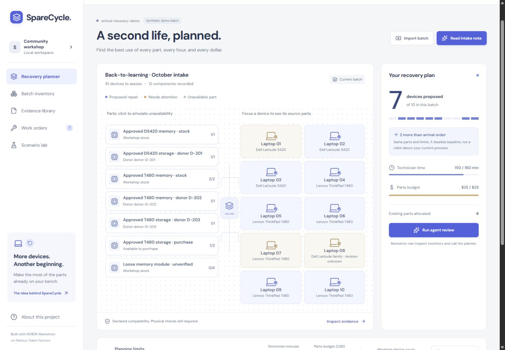

# SpareCycle

**Choose the repair batch that gets more laptops ready for their next owner.**

SpareCycle is a planning desk for laptop refurbishing coordinators. It combines diagnosed device needs, tested spare parts, approved donor devices, declared exact-SKU compatibility, and a fixed workshop budget. Its deterministic allocator proposes a batch of repairs, explains blocked alternatives, and recalculates when a donor part fails.

Built for the **Best Apps and Agents** track of the Nebius x NVIDIA Global AI Hackathon.

- Live application: [sparecycle-topaz.vercel.app](https://sparecycle-topaz.vercel.app)
- Public repository: [Golden007-prog/sparecycle](https://github.com/Golden007-prog/sparecycle) — repository created; source push pending.
- Public YouTube demonstration: **remaining submission task**
- License: [MIT](LICENSE)
- Verified: **37 automated tests and the production build passed; the public manual planner loads anonymously.**
- Live NVIDIA intake succeeded in **9.35 seconds**; delivered LangSmith intake and planner-tool records were inspected with empty inputs/outputs. Full batch-agent completion remains **pending verification**. See [validation evidence](docs/VALIDATION.md).

Actual browser capture of the synthetic workshop. A [mobile capture](docs/assets/sparecycle-mobile.jpg) is also included.

## The workshop workflow

1. Open the clearly labeled synthetic batch, or import workshop records as JSON using the application's template.
2. Review diagnosed needs, stock, approved donor parts, compatibility evidence, labor estimates, and release requirements.
3. Set the technician-time and purchase-budget limits.
4. Compare the baseline and optimized allocations under the same constraints.
5. Inspect why a particular part goes to a particular device and why other candidates are blocked.
6. Mark a donor component unavailable to replay a failure and generate a revised plan.
7. Review and export the report and work orders. Record physical work and final checks separately.

The central trade-off is across devices: using a scarce part on the first repair can prevent a more useful combination of repairs. The interface makes each allocation and the remaining constraints inspectable.

The main bench is a schematic overview of part sources and device outcomes. Open a device to inspect its exact component allocations and evidence; the central spine does not draw every source-to-recipient connection.

Batch import accepts JSON only. Work orders export as CSV, and the evidence packet exports as JSON. These report exports are different from the batch import schema. Use the downloaded batch template for imports; review and edit extracted intake records before constructing a batch. CSV import is not implemented.

**The sample inventory, diagnostic records, compatibility declarations, costs, and outcomes are synthetic.** A sample record marked verified means the fictional scenario declares that evidence; it is not manufacturer verification or certification. Plans predict what could be repaired under supplied assumptions. They do not prove that any physical device has been repaired, wiped, tested, or delivered.

## Architecture

~~~text
React + Vite + TypeScript workshop interface
  |-- Browser-local inventory, scenarios, and review state
  |-- Deterministic constrained batch allocator
  `-- Vercel /api/analyze (server only)
        |-- NVIDIA Nemotron through Nebius Token Factory
        |-- list_inventory / inspect_device / compute_recovery_plan
        `-- Optional LangSmith operational metadata
~~~

Nemotron turns supplied notes into a draft for coordinator review and explains tool results. It does not diagnose hardware from symptoms, create compatibility facts, certify erasure, or execute repairs. The tools read the supplied inventory and invoke deterministic planning; the model does not override resource constraints.

The prototype stores a single workshop's state in the browser. Supabase is not needed for this scope. Shared accounts, synchronized inventory, permissions, and concurrent stock reservations belong to a future team version.

## Run locally

Use **Node.js 22 LTS** and npm.

~~~sh
npm install
~~~

Copy the environment template:

~~~powershell
# Windows PowerShell
Copy-Item .env.example .env.local
~~~

~~~sh
# macOS / Linux
cp .env.example .env.local
~~~

Add server credentials to .env.local, then start the app:

~~~sh
npm run dev
~~~

Open the address printed by the server, normally http://localhost:3000. The development server loads .env.local and serves both the interface and API. Manual records and deterministic planning do not require an AI key. An unavailable provider must produce an explicit error, not a sample answer presented as live AI.

~~~sh
npm test
npm run build
~~~

These are reproduction commands, not a claim that release checks have passed. The build checks TypeScript and produces the Vite frontend. The preview command serves the frontend only; use the development server or Vercel for API features.

## Configuration

| Server variable | Purpose |
| --- | --- |
| NEBIUS_API_KEY | Required for live Nemotron calls. |
| NEBIUS_MODEL | Intended default: nvidia/Nemotron-3_5-Lightning. Record the actual successful deployed model before submitting. |
| LANGSMITH_API_KEY | Optional tracing credential. |
| LANGSMITH_PROJECT | Use sparecycle for a dedicated trace project. |
| LANGSMITH_WORKSPACE_ID | Actual workspace UUID when required by the key. The organization ID in a LangSmith /o/ URL is not a workspace ID. |
| LANGSMITH_ENDPOINT | Usually https://api.smith.langchain.com; use the endpoint appropriate to your workspace. |
| LANGSMITH_TRACING | Set to false to disable optional tracing. |
| APP_ORIGIN | Optional canonical deployed browser origin. |
| PORT | Local port; defaults to 3000. |

Requests use https://api.tokenfactory.nebius.com/v1/. The OpenAI SDK is the compatibility client; **Nebius serves the NVIDIA model**. [Nebius quickstart](https://docs.tokenfactory.nebius.com/quickstart) and [API reference](https://api.tokenfactory.nebius.com/docs).

Keep keys on the server. Never commit .env.local or expose credentials with a VITE_ prefix. Configuration flags indicate presence of settings, not proof of inference or trace delivery.

## Allocator and baseline

The allocator jointly searches device subsets and part assignments. Its objective, in order, is to maximize complete repair candidates, maximize their summed priority, minimize incremental cash, and minimize technician time. The search is capped at 200,000 states; a capped result reports that optimality is unproven.

The supported planning size is at most 18 devices, 40 part rows, and six needed component units per device. Only exact-SKU relationships with declared verified availability and evidence references are eligible. Dedicated donor records are inventory sources and cannot also be repair candidates. Technician time includes per-device repair time and per-unit harvest/preparation time.

The baseline processes devices in intake order and greedily prefers lower-cash, then lower-preparation-time parts under the same constraints. It is an algorithmic comparison, not a measured representation of human performance.

## Recorded domain verification

On 10 October 2026, the targeted recovery test suite passed **11 tests**, including an independent brute-force comparison across **24 varied small batches** and a capped-search feasibility check:

~~~sh
npx tsx --test tests/recovery.test.ts
~~~

For the fixed synthetic fixture with a $25 purchase budget and 180 technician minutes:

| Result | Intake-order baseline | Allocator |
| --- | --- | --- |
| Projected complete repair candidates | 5 | 7 |
| Incremental cash | $25 | $25 |
| Planned technician time | 160 minutes | 150 minutes |

Making part-t480-ram-donor unavailable reduces the allocator's result to six projected candidates. These are reproducible modeled outcomes, not physical repairs or measured customer gains.

The complete current suite passed **37 tests: 23 API, 11 domain, and 3 export tests**. The production build passed. Browser checks confirmed the default seven-candidate plan, the six-candidate donor-failure result, identity-hold inspection, invalid-import rejection, and a valid one-device JSON import followed by restoring the demo.

At 390-pixel mobile width, no horizontal overflow was observed. Closed navigation is hidden from the accessibility tree; opening it focuses Recovery planner, Escape restores the navigation toggle, and page selection moves focus to the main content. Anonymous HTML access returned HTTP 200 and the manual planner loaded. Live intake and inspected trace records are verified; full batch-agent completion remains pending in [VALIDATION.md](docs/VALIDATION.md).

## Planning and evidence rules

- Compatibility is an explicit approved relationship between exact device and part SKUs, with provenance. Unknown or unsupported relationships are blocked. Similar names, connectors, or dimensions are insufficient.
- Only components declared tested and available can be allocated. Quantities cannot be double-used. Donor availability and any donor/recipient restrictions must be enforced.
- A complete repair candidate needs all required components and must fit the active time and budget constraints.
- The plan describes its objective and search status. A bounded or incomplete search must not be labeled globally optimal.
- Baseline and optimized plans use the same supplied facts and constraints. A positive difference on one synthetic scenario is not measured customer improvement.
- Planned recovery is separate from release readiness. Final QA, data-wipe evidence, supported operating-system policy, and technician review remain necessary before release.
- Estimates can be wrong. Unexpected faults, damaged donors, inaccurate labor estimates, and stale stock require reassessment.

## Deployment and verification

The app is deployed at [sparecycle-topaz.vercel.app](https://sparecycle-topaz.vercel.app). Production health reports NVIDIA nvidia/Nemotron-3_5-Lightning configured, and a real intake request succeeded. LangSmith intake and planner-tool records were delivered and inspected. Full batch-agent completion is still being verified. For another deployment, import the repository into Vercel, apply server environment variables, and verify anonymous access, tool execution, errors, imports, and exports.

The API bounds payloads, tool execution, output, and request duration. In-memory throttles operate per server instance: restarts and horizontal scaling reset or multiply them. They are not a durable account-wide spend cap. A production service needs authenticated access, shared quotas, and provider budget controls.

## Data and privacy

Browser storage is not an encrypted vault, a team database, or a reliable backup. Export records you need to keep, and use synthetic information in the public demo.

AI requests send supplied notes and relevant workshop context through the server to Nebius. Local storage does not mean on-device inference. Never submit customer files, passwords, device contents, or unnecessary personal information.

Optional LangSmith tracing is designed to retain action/model/status, tool names, and aggregate counts while hiding input and output content. Verify actual trace contents before sharing them. [LangSmith privacy controls](https://docs.langchain.com/langsmith/mask-inputs-outputs).

The app does not erase disks, alter hardware, purchase parts, submit external messages, or certify a device. Work orders are drafts for qualified staff. External manufacturer instructions and organizational policies remain authoritative.

## Research and submission materials

- [Need, competitors, and winner-inspired mechanisms](docs/RESEARCH.md)
- [Business hypotheses and validation](docs/BUSINESS.md)
- [Devpost draft and eligibility checklist](docs/DEVPOST.md)
- [Three-minute demo script](docs/DEMO-SCRIPT.md)
- [Delivery plan](docs/PLAN.md)
- [Workshop interface design](docs/DESIGN.md)
- [Release-readiness checklist](docs/RELEASE.md)
- [Recorded validation evidence](docs/VALIDATION.md)

Existing products already manage repairs, harvest components, and route devices. SpareCycle's proposed contribution is inspectable **whole-batch allocation under scarce parts and workshop constraints**, with failure replay and explicit evidence gaps. Competitive exclusivity and customer demand have not been established.
