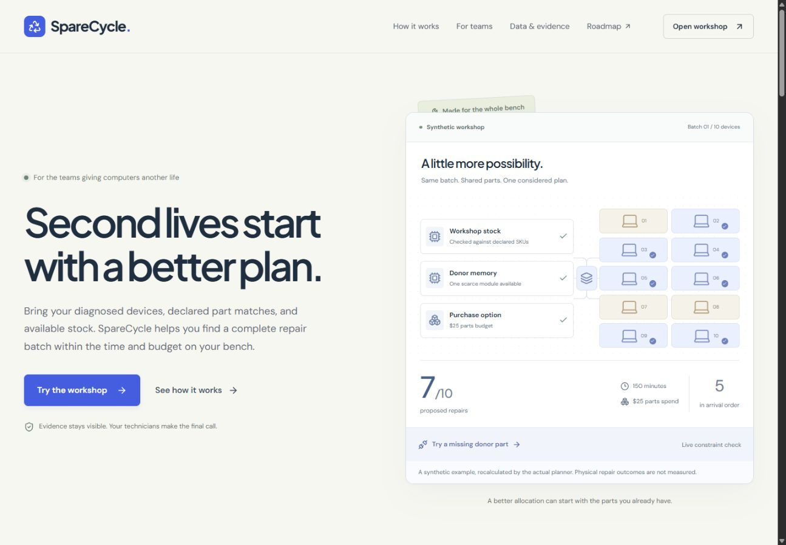

# SpareCycle

**Choose the repair batch that gets more laptops ready for their next owner.**

SpareCycle is a planning desk for laptop refurbishing coordinators. It combines diagnosed device needs, tested spare parts, approved donor devices, declared exact-SKU compatibility, and a fixed workshop budget. Its deterministic allocator proposes a batch of repairs, explains blocked alternatives, and recalculates when a donor part fails.

Built for the **Best Apps and Agents** track of the Nebius x NVIDIA Global AI Hackathon.

- Live application: [sparecycle-topaz.vercel.app](https://sparecycle-topaz.vercel.app)
- Workshop: [Open the planner](https://sparecycle-topaz.vercel.app/app) · [Start company setup](https://sparecycle-topaz.vercel.app/app?setup=1)
- Public source: [Golden007-prog/sparecycle](https://github.com/Golden007-prog/sparecycle) — website and company-pilot runtime commit `e17998f` is published on main.
- Public YouTube demonstration: **remaining submission task**
- License: [MIT](LICENSE)
- Release evidence: **56 automated tests passed**, production builds passed, and [GitHub CI passed](https://github.com/Golden007-prog/sparecycle/actions/runs/38022439465). Local browser checks covered company, CSV, catalog, backup and responsive website flows; public pages, setup and catalog links were verified on production. See [VALIDATION.md](docs/VALIDATION.md) for the scope of each check.
- A fresh deployed NVIDIA batch-agent review succeeded in **4.1 seconds**, executing inventory and planning tools. Earlier live intake succeeded in 9.35 seconds and a batch review in 2.8 seconds. Earlier LangSmith root/tool records were inspected with empty inputs/outputs; the new request returned a trace ID but that trace's contents have not been reinspected.

Actual browser capture of the public website. The interactive synthetic example recalculates with the real allocator. See the [mobile website](docs/assets/sparecycle-landing-mobile.jpg), [company workspace](docs/assets/sparecycle-company-desktop.jpg), and [company mobile capture](docs/assets/sparecycle-company-mobile.jpg).

## The workshop workflow

The public website includes [how it works](https://sparecycle-topaz.vercel.app/how-it-works), a [company pilot guide](https://sparecycle-topaz.vercel.app/for-teams), and [data provenance](https://sparecycle-topaz.vercel.app/data). Companies can download the [pilot kit](https://sparecycle-topaz.vercel.app/samples/sparecycle-pilot-kit.zip) with CSV templates and public documentation. The [searchable roadmap](https://sparecycle-topaz.vercel.app/roadmap.html) separates shipped story flags from planned work and differentiation hypotheses.

1. Create a browser-local company profile through three-step setup: workshop details, default planning limits, and the first batch. The prototype supports up to eight profiles and 20 saved batches per profile.
2. Open the clearly labeled synthetic batch, or import workshop records using the Devices and Parts CSV templates or the JSON batch template. Name and save separate batches; changes to a selected saved batch autosave locally.
3. Review diagnosed needs, stock, approved donor parts, compatibility evidence, labor estimates, and release requirements.
4. Set technician-time and purchase-budget limits, then compare baseline and optimized allocations under the same constraints.
5. Inspect exact allocations and blocked candidates. Mark a donor component unavailable to replay a failure and generate a revised plan.
6. Review and export the report and work orders. Record physical work and final checks separately.
7. Export a workspace backup before removing records or clearing storage. Restoration validates the backup and adds separate restored company profiles with new identifiers, preserving existing profiles and batches. The same workspace limits apply.

The central trade-off is across devices: using a scarce part on the first repair can prevent a more useful combination of repairs. The interface makes each allocation and the remaining constraints inspectable.

The main bench is a schematic overview of part sources and device outcomes. Open a device to inspect its exact component allocations and evidence; the central spine does not draw every source-to-recipient connection.

Batch import accepts two CSV files (Devices and Parts) or a JSON batch. Work orders export as CSV, and evidence packets export as JSON. Report exports, batch templates, and complete workspace backups have different schemas and restore/import flows. Review and edit AI intake drafts before constructing a batch. See the [company quickstart](docs/COMPANY-QUICKSTART.md) for field constraints and the [company adoption guide](docs/COMPANY-ADOPTION.md) for a pilot workflow.

**The sample inventory, diagnostic records, compatibility declarations, costs, and outcomes are synthetic.** A sample record marked verified means the fictional scenario declares that evidence; it is not manufacturer verification or certification. Plans predict what could be repaired under supplied assumptions. They do not prove that any physical device has been repaired, wiped, tested, or delivered.

## Architecture

~~~text
React + Vite + TypeScript workshop interface
  |-- Browser-local inventory, scenarios, and review state
  |-- Company profiles, named batches, CSV/JSON import, and workspace backups
  |-- Historical laptop reference catalog
  |-- Deterministic constrained batch allocator
  `-- Vercel /api/analyze (server only)
        |-- NVIDIA Nemotron through Nebius Token Factory
        |-- list_inventory / inspect_device / compute_recovery_plan
        `-- Optional LangSmith operational metadata
~~~

Nemotron turns supplied notes into a draft for coordinator review and explains tool results. It does not diagnose hardware from symptoms, create compatibility facts, certify erasure, or execute repairs. The tools read the supplied inventory and invoke deterministic planning; the model does not override resource constraints.

Company profiles and saved batches remain in one browser. They organize records but do not create authenticated company accounts, tenant isolation on a server, or synchronization between teammates. Supabase is not used. Shared inventory, permissions, audit history, and concurrent stock reservations belong to a future team version.

## Reference data and product roadmap

The model catalog contains **291 historical laptop listing variants across 14 brands**, derived from a Kaggle dataset whose uploader declares **CC0-1.0**. Its last update was February 2023. The importer excluded incomplete or malformed rows and retained source-row references. Specifications remain unverified retailer claims; historical INR prices are not current offers or the planner's USD repair costs. Catalog matches never approve a replacement part, diagnosis, condition, or release. See [data sources and reproducible filtering](docs/DATA-SOURCES.md).

The [interactive roadmap](https://sparecycle-topaz.vercel.app/roadmap.html) is built from `public/roadmap.html` and the [feature catalog](docs/FEATURES.md). The current catalog contains **520 workflow stories**, including **216 MVP candidates**; **29 stories are currently marked shipped and 491 planned**. These are product-planning records, not a count of distinct implemented screens or buttons. Company capabilities awaiting catalog acceptance remain planned. The roadmap is not a promise that the full product exists. Local browser checks confirmed the 216-candidate filter and exact story-ID search.

## Run locally

Use **Node.js 22 LTS** and npm.

~~~sh
npm install
~~~

Copy the environment template:

~~~powershell
# Windows PowerShell
Copy-Item .env.example .env.local
~~~

~~~sh
# macOS / Linux
cp .env.example .env.local
~~~

Add server credentials to .env.local, then start the app:

~~~sh
npm run dev
~~~

Open the address printed by the server, normally http://localhost:3000. The development server loads .env.local and serves both the interface and API. Manual records and deterministic planning do not require an AI key. An unavailable provider must produce an explicit error, not a sample answer presented as live AI.

~~~sh
npm test
npm run build
~~~

These are reproduction commands, not a claim that release checks have passed. The build checks TypeScript and produces the Vite frontend. The preview command serves the frontend only; use the development server or Vercel for API features.

## Configuration

| Server variable | Purpose |
| --- | --- |
| NEBIUS_API_KEY | Required for live Nemotron calls. |
| NEBIUS_MODEL | Default: nvidia/Nemotron-3_5-Lightning; verified in the earlier deployed intake and planning smoke checks. |
| LANGSMITH_API_KEY | Optional tracing credential. |
| LANGSMITH_PROJECT | Use sparecycle for a dedicated trace project. |
| LANGSMITH_WORKSPACE_ID | Actual workspace UUID when required by the key. The organization ID in a LangSmith /o/ URL is not a workspace ID. |
| LANGSMITH_ENDPOINT | Usually https://api.smith.langchain.com; use the endpoint appropriate to your workspace. |
| LANGSMITH_TRACING | Set to false to disable optional tracing. |
| APP_ORIGIN | Optional canonical deployed browser origin. |
| PORT | Local port; defaults to 3000. |

Requests use https://api.tokenfactory.nebius.com/v1/. The OpenAI SDK is the compatibility client; **Nebius serves the NVIDIA model**. [Nebius quickstart](https://docs.tokenfactory.nebius.com/quickstart) and [API reference](https://api.tokenfactory.nebius.com/docs).

Keep keys on the server. Never commit .env.local or expose credentials with a VITE_ prefix. Configuration flags indicate presence of settings, not proof of inference or trace delivery.

## Allocator and baseline

The allocator jointly searches device subsets and part assignments. Its objective, in order, is to maximize complete repair candidates, maximize their summed priority, minimize incremental cash, and minimize technician time. The search is capped at 200,000 states; a capped result reports that optimality is unproven.

The supported planning size is at most 18 devices, 40 part rows, and six needed component units per device. Only exact-SKU relationships with declared verified availability and evidence references are eligible. Dedicated donor records are inventory sources and cannot also be repair candidates. Technician time includes per-device repair time and per-unit harvest/preparation time.

The baseline processes devices in intake order and greedily prefers lower-cash, then lower-preparation-time parts under the same constraints. It is an algorithmic comparison, not a measured representation of human performance.

## Recorded domain verification

On 10 October 2026, the targeted recovery test suite passed, including an independent brute-force comparison across **24 varied small batches** and a capped-search feasibility check:

~~~sh
npx tsx --test tests/recovery.test.ts
~~~

For the fixed synthetic fixture with a $25 purchase budget and 180 technician minutes:

| Result | Intake-order baseline | Allocator |
| --- | --- | --- |
| Projected complete repair candidates | 5 | 7 |
| Incremental cash | $25 | $25 |
| Planned technician time | 160 minutes | 150 minutes |

Making part-t480-ram-donor unavailable reduces the allocator's result to six projected candidates. These are reproducible modeled outcomes, not physical repairs or measured customer gains.

The company release passed **56 tests: 24 API, 11 domain, 3 export, 7 CSV and 11 workspace tests**. Production builds passed in the working project, delivery copy and Vercel deployment, and [GitHub CI passed](https://github.com/Golden007-prog/sparecycle/actions/runs/38020705745). The source secret check reported no findings across 73 checked files. Earlier browser checks confirmed the seven-candidate fixture, the six-candidate donor-failure result, identity hold and valid/invalid JSON imports.

Local browser checks on the company release covered three-step setup, independent named-batch limits, reload persistence, CSV import with one proposed and one held device, company switching that clears reviews/checklists, rejection of an invalid backup, and restoration without overwriting two existing profiles. Catalog search returned two ThinkPad references and handled no-match results. At an actual 355-CSS-pixel viewport, no horizontal overflow was observed and navigation focus was checked. These checks do not constitute a comprehensive accessibility audit.

The published company interface loaded and its setup dialog opened. A fresh live batch-agent review executed `list_inventory` and `compute_recovery_plan`, returning seven projected candidates, a five-candidate baseline, $25 cost and 150 technician minutes in 4.1 seconds. These are individual smoke checks, not latency or customer-outcome benchmarks; details are in [VALIDATION.md](docs/VALIDATION.md).

## Planning and evidence rules

- Compatibility is an explicit approved relationship between exact device and part SKUs, with provenance. Unknown or unsupported relationships are blocked. Similar names, connectors, or dimensions are insufficient.
- Only components declared tested and available can be allocated. Quantities cannot be double-used. Donor availability and any donor/recipient restrictions must be enforced.
- A complete repair candidate needs all required components and must fit the active time and budget constraints.
- The plan describes its objective and search status. A bounded or incomplete search must not be labeled globally optimal.
- Baseline and optimized plans use the same supplied facts and constraints. A positive difference on one synthetic scenario is not measured customer improvement.
- Planned recovery is separate from release readiness. Final QA, data-wipe evidence, supported operating-system policy, and technician review remain necessary before release.
- Estimates can be wrong. Unexpected faults, damaged donors, inaccurate labor estimates, and stale stock require reassessment.

## Deployment and verification

The company-workspace runtime `0a28d2b` is deployed at [sparecycle-topaz.vercel.app](https://sparecycle-topaz.vercel.app), with [this versioned deployment](https://sparecycle-8rh0xw9ax-basuoikantik-7538s-projects.vercel.app). The fresh live review used `nvidia/Nemotron-3_5-Lightning` through Nebius and returned trace ID `fcdf679d-8ea7-44fc-9582-a8fcfccf0915`. Earlier LangSmith intake, successful plan and tool records were inspected with empty inputs/outputs; the new trace's contents have not been reinspected. The delivery copy is at `E:/LOCAL helper/sparecycle`.

The current release uses manual Vercel deployments. Automatic deployment from GitHub is not connected: Vercel's Git connection requires a GitHub Login Connection on the account. Public source and the manual production deployment work independently. For another deployment, apply server environment variables and verify anonymous access, tool execution, errors, imports, and exports.

The API bounds payloads, tool execution, output, and request duration. In-memory throttles operate per server instance: restarts and horizontal scaling reset or multiply them. They are not a durable account-wide spend cap. A production service needs authenticated access, shared quotas, and provider budget controls.

## Data and privacy

Browser storage is not an encrypted vault, a team database, or a reliable backup. Export records you need to keep, and use synthetic information in the public demo.

AI requests send supplied notes and relevant workshop context through the server to Nebius. Local storage does not mean on-device inference. Never submit customer files, passwords, device contents, or unnecessary personal information.

Optional LangSmith tracing is designed to retain action/model/status, tool names, and aggregate counts while hiding input and output content. Verify actual trace contents before sharing them. [LangSmith privacy controls](https://docs.langchain.com/langsmith/mask-inputs-outputs).

The app does not erase disks, alter hardware, purchase parts, submit external messages, or certify a device. Work orders are drafts for qualified staff. External manufacturer instructions and organizational policies remain authoritative.

## Research and submission materials

- [Need, competitors, and winner-inspired mechanisms](docs/RESEARCH.md)
- [Business hypotheses and validation](docs/BUSINESS.md)
- [Company quickstart and CSV preparation](docs/COMPANY-QUICKSTART.md)
- [Company adoption and pilot scope](docs/COMPANY-ADOPTION.md)
- [Kaggle source, quality report and limitations](docs/DATA-SOURCES.md)
- [Feature catalog and roadmap status](docs/FEATURES.md)
- [Devpost draft and eligibility checklist](docs/DEVPOST.md)
- [Three-minute demo script](docs/DEMO-SCRIPT.md)
- [Delivery plan](docs/PLAN.md)
- [Workshop interface design](docs/DESIGN.md)
- [Release-readiness checklist](docs/RELEASE.md)
- [Recorded validation evidence](docs/VALIDATION.md)

Existing products already manage repairs, harvest components, and route devices. SpareCycle's proposed contribution is inspectable **whole-batch allocation under scarce parts and workshop constraints**, with failure replay and explicit evidence gaps. Competitive exclusivity and customer demand have not been established.
