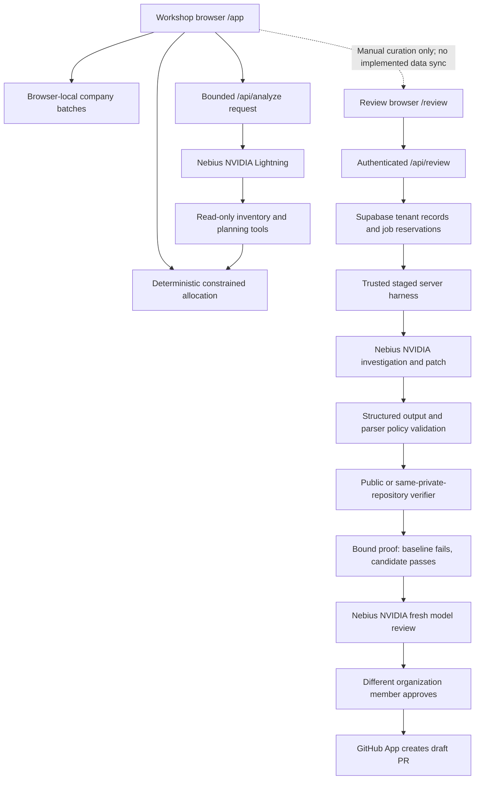

# SpareCycle backend evidence and demo reference

Audited against the local implementation and recorded execution evidence on **11 October 2026**. This document makes no new model calls, changes no cloud records and does not treat a replayed recording as a fresh execution. The published runtime at the time of this audit is `2714ffd0476c116e57100fe4a910800381aecae7`; subsequent documentation commits record delivery checks. See the dated [release record](RELEASE.md).

SpareCycle has two implemented workflows: a browser-local refurbishment planner and an authenticated diagnostic-code review service. The strongest demonstrated Review result is a **synthetic parser defect repaired through real Nebius inference, isolated private GitHub verification and a separately approved draft PR**. This is a bounded pilot, not arbitrary repository repair, physical hardware repair or a certified enterprise platform.

## Two workflows, two data boundaries

Routing is in [`src/main.tsx`](../src/main.tsx). Workshop persistence is in [`src/App.tsx`](../src/App.tsx) and [`lib/workspace.ts`](../lib/workspace.ts); Review data access is in [`lib/review/store.ts`](../lib/review/store.ts). The dotted handoff describes something an operator can do manually, not an integration endpoint.

| Workflow | Actual inputs and result | Boundary to preserve in the video |
| --- | --- | --- |
| Workshop | Reviewed device/part inventory, exact declared SKUs, holds and budget/time limits produce proposed allocations and work-order exports. The deterministic planner searches bounded combinations. | Workspace names are local browser profiles, not Supabase organizations. Proposals do not certify compatibility, repair, wiping or QA. |
| Workshop AI | Technician text can become a reviewable intake draft. Nebius can call supplied read-only inventory/planning tools and explain the deterministic result. | AI cannot approve untested stock or replace allocator totals. The endpoint has process-local limits, not Review's durable tenant quotas. |
| Review | Organization members record laptop passports and evidence, connect a permitted repository, propose one diagnostic parser change, test it, review it and create a draft. | A passport is a supplied record, not telemetry collected by an installed laptop agent. A tested code change does not make a physical laptop ready to donate. |

Workshop's default model is Lightning. [`lib/ai.ts`](../lib/ai.ts), `runAnalysis`, supplies only `list_inventory`, `inspect_device` and `compute_recovery_plan`: at most three tool rounds and six tool calls, with a 55-second overall deadline and 20-second provider deadline. Requests are bounded to 24,000 bytes, with 16,000 bytes of planning context. [`lib/recovery.ts`](../lib/recovery.ts), `planRecovery`, owns allocation; its 200,000-state cap can produce an explicitly non-optimal result. Browser persistence supports at most eight workspaces and twenty saved batches per workspace. [`api/analyze.ts`](../api/analyze.ts), `RequestLimiter`, explicitly documents its instance-local nature.

## Review: browser to draft PR

### 1. Authenticate the person, then authorize each organization action

[`src/review-client.ts`](../src/review-client.ts), `createReviewAuth` and `reviewRequest`, use Supabase session handling and send the active user bearer token to `/api/review`. Browser sessions persist; provider API keys and GitHub App signing keys do not belong in this client. The server's public GET response contains publishable configuration and configured-service flags, not a live connectivity test.

[`api/review.ts`](../api/review.ts) rejects unsupported origins, non-JSON actions, unknown schema fields and bodies over 32 KiB. It marks responses private/no-store and returns a request identifier. [`lib/review/auth.ts`](../lib/review/auth.ts), `authenticateReviewRequest`, performs a live Supabase `getUser(token)` check and carries that user's JWT into the data client. It does not grant tenant access through a service-role client. Ordinary Google login has been observed on the live site, including reload persistence and an empty organization list for the newly signed-in account; login alone grants no organization membership.

### 2. Store organization-scoped records and reserve work before inference

[`lib/review/store.ts`](../lib/review/store.ts) reads tenant-scoped organizations, members, laptop passports, evidence, projects, changes, jobs, budgets and audit records. The base [Review migration](../supabase/migrations/20261010043058_sparecycle_review.sql) enables RLS on the public Review tables, limits SELECT to members, revokes direct authenticated writes and routes mutations through role-aware database functions. Worker operations also require a separate server-held worker proof. Evidence and audit records are append-only under the implemented mutation path.

`reserveJob` and `claimJob` enforce organization-scoped idempotency, one active job per change, a 75-second claim lease, rolling daily quotas and bounded concurrency. Defaults in the migration are twenty jobs per organization per rolling day, one hundred globally, two active jobs per organization and four globally. Organization spend is reserved against its monthly budget; the separate global runtime ceiling is an aggregate ceiling without an automatic monthly reset. These are conservative service controls, not a reconciliation with a provider invoice.

The default organization and global ceilings in the migration are 100 cents each; operators can change permitted settings. A stage reserves an upper-bound estimate before calling the model. An interrupted external call is marked uncertain and is not repeated automatically. Saved checkpoints enable explicit continuation without putting the complete workflow inside one serverless request.

**Cloud boundary:** the base schema and two earlier follow-up migrations were applied in the recorded release. [`20261010060900_review_conflict_codes_and_lock_order.sql`](../supabase/migrations/20261010060900_review_conflict_codes_and_lock_order.sql) passed local tests but is still pending in cloud. Do not describe its improved conflict codes/lock order as deployed behavior.

### 3. Bind evidence and repository authority

[`lib/review/service.ts`](../lib/review/service.ts), `focusedEvidence`, composes the case description, selected passport fields and versioned evidence in a stable order. The service requires evidence, rejects an out-of-date evidence version, and limits the focused JSON string to 18,000 characters and fewer than fifty evidence records. The harness adds its own strict evidence validation.

`connectProject` requires an organization owner or administrator. [`lib/review/github.ts`](../lib/review/github.ts), `discoverRepository`, independently checks the connecting person's one-time GitHub credential and the selected GitHub App installation's access. That credential is not stored as an ongoing project secret. A later snapshot binds the immutable commit, tree, repository/installation identity, selected regular source/test blobs and content digests. Private visibility is refreshed from GitHub, not trusted from a browser-supplied flag.

The public action schema in [`lib/review/request.ts`](../lib/review/request.ts) accepts exactly one target under `src/diagnostics/*.mjs` and one to four existing files under `tests/diagnostics/*.test.mjs`. Lower-level engine support for a larger bound is not the public API contract. No repository-wide indexing, arbitrary dependency installation or automatic discovery of every failing test is implemented.

### 4. Ask Nebius for bounded proposals; keep execution authority in the server

[`lib/review/harness.ts`](../lib/review/harness.ts) sends requests to **Nebius Token Factory**, `https://api.tokenfactory.nebius.com/v1/`, using an OpenAI-compatible client. That client does not mean OpenAI supplies inference. The deployed model identities are NVIDIA Nemotron models.

| Tier | Exact model ID | Implemented routing and observed use |
| --- | --- | --- |
| Nano | `nvidia/NVIDIA-Nemotron-3-Nano-30B-A3B` | Selectable investigation; used for the recorded private case and a separate recorded production investigation. |
| Lightning | `nvidia/Nemotron-3_5-Lightning` | Default Review investigation and default Workshop model; recorded public Review investigation and Workshop tool workflow. |
| Super | `nvidia/nemotron-3-super-120b-a12b` | Patch generation and fresh model review for non-Ultra cases; both completed in the private pilot. Selecting Nano for investigation does not make patching use Nano. |
| Ultra | `nvidia/Nemotron-3-Ultra-550b-a55b` | Explicit selectable escalation only when the operator enables `NEBIUS_REVIEW_ALLOW_ULTRA`; recorded bounded investigation test. No superiority benchmark is established. |

`tierFor` in [`service.ts`](../lib/review/service.ts) chooses Super for patch/review unless the case explicitly selects Ultra. This is stage-based routing, not a simultaneous four-model debate. Omni, vision and dedicated-endpoint models shown in a provider catalog are not integrated merely because they are available there.

Investigation accepts only `software`, `hardware` or `insufficient_evidence`. Hardware and insufficient-evidence results lead to their respective review states; only a software classification can proceed to patch generation. Investigation sees focused evidence. Patching sees evidence plus the bounded source/test snapshot. Fresh review sees the original case, before/after source, unchanged tests and verification proof, without the writer's conversation history.

All Review stages use strict structured schemas, a maximum 100,000-byte JSON context, a maximum 40-second provider deadline and **zero automatic provider retries**. Output limits are 8,192 tokens for patching and 4,096 for investigation/review. Truncated, refused, oversized, invalid JSON or tool-call responses are rejected. The 120,000-input-token reservation is a conservative budgeting bound, not a claim that every call consumes that amount. Configured token rates and rounded cent charges are estimates.

The Review model receives no shell, network, file-write or publishing tools. Its result is a proposal. The trusted server validates and performs each allowed operation. [`scripts/review-parser-policy.mjs`](../scripts/review-parser-policy.mjs) applies an Acorn-based syntax policy to the pure parser: preserve exports, no imports or dependencies, no ambient process access, dynamic code evaluation or arbitrary I/O. This syntax policy is one layer; it is not itself a security sandbox.

### 5. Verify the original failure and the exact candidate

[`lib/review/actions-runner.ts`](../lib/review/actions-runner.ts) dispatches and validates real GitHub Actions verification. The current exercised execution provider is **GitHub Actions isolated containers**. [`lib/review/sandbox.ts`](../lib/review/sandbox.ts) contains a Nebius Sandboxes adapter and tests, but that adapter was not activated or demonstrated in the recorded release. Nebius inference and GitHub execution must be drawn as separate services.

Public source can use the pinned shared [public workflow](../.github/workflows/review-verify.yml). Private source requires an explicit organization/repository/installation/verifier/key binding and the [private workflow](../.github/workflows/review-private-verify.yml) in the **same private repository**. There is no private-to-public fallback. Up to twenty operator-provisioned private bindings are supported; the user-facing connection form is not self-service runner provisioning.

[`scripts/review-private-payload.mjs`](../scripts/review-private-payload.mjs) encrypts private source/test/candidate transport using a fresh AES-256-GCM key wrapped with RSA-OAEP-SHA256. The authenticated context binds organization, repository, installation, immutable verifier SHA, key fingerprint and nonce. The dispatch envelope is limited to 60 KB. The private key stays in that repository's Actions secret. The verifier checks the actual GitHub event/repository/workflow identity and first run attempt before decryption.

[`scripts/review-verify.mjs`](../scripts/review-verify.mjs) runs baseline and candidate in separate digest-pinned Node containers with no network, read-only filesystems, non-root user, dropped capabilities, no new privileges, at most 64 processes, 256 MB memory, one CPU, bounded temporary storage, a 40-second execution deadline and bounded output. App, Supabase and Nebius credentials do not enter these test containers. No application dependency installation occurs inside them.

A passing candidate alone is insufficient: at least one original test must fail, the same named test inventory must execute, the candidate must pass every case, and skipped/todo/cancelled cases do not count as success. [`scripts/review-integrity.mjs`](../scripts/review-integrity.mjs) binds canonical snapshot and candidate digests. The accepted proof binds source/base, candidate, original evidence, named tests, runner identity and, for private execution, the encrypted dispatch and tenant binding. The private artifact contains metadata-only `proof.json`, not source or raw test output. Hashes establish correspondence to recorded artifacts, not general program correctness or hardware repair.

### 6. Require a fresh model review and a different human account

`reviewCandidate` in [`harness.ts`](../lib/review/harness.ts) examines the reported defect, exact code and proof. Passing tests do not automatically approve a change. The model can reject uncertainty; there is no automatic retry until a reviewer approves.

Database `approveChange` checks reviewer role, a different account from the requester, and the exact evidence version, base commit and patch hash. The service rejects stale approval and changed evidence. The recorded demo used two synthetic accounts to exercise this separation; it was not an actual customer's employee approval.

### 7. Publish a draft, preserving what was tested

[`lib/review/github.ts`](../lib/review/github.ts), `publishDraft`, rechecks repository identity/visibility and the base branch, verifies proof and approval bindings, and writes only the selected parser change to a draft branch. It can resume an exact compatible partial publication without overwriting a mismatching branch. Existing tests remain unchanged. The PR body carries selected verification metadata and omits raw laptop evidence, private case title and model rationale.

`published` is the application's state for **draft PR created**. The feature does not merge, deploy the customer project, push a device update or certify resolution on a laptop. GitHub administrators still control visibility, workflow policy and final merge decisions. GitHub provides no atomic transaction covering a visibility check plus a later write.

## Recorded evidence: what each check actually establishes

Saved reports under `test-results/` are intentionally ignored local audit artifacts. They are not shipped as public data or universally accessible links. The public repository's release documents, public PR and CI run provide portable references. Private GitHub links require the selected repository's access.

| Evidence | Observation | What it does not establish |
| --- | --- | --- |
| [Release validation](RELEASE.md), runtime `2714ffd`; [CI run 38109161627](https://github.com/Golden007-prog/sparecycle/actions/runs/38109161627) | 200 automated tests and production build passed; desktop and 390px authentication layouts checked. | Comprehensive security, load, accessibility or customer acceptance certification. This audit did not rerun that suite. |
| `test-results/review-private-live-flow-state.json` | Real private case `9307d8bd-a0b3-45bb-9cff-46c68690663e` completed five job stages; self-approval denied, separate reviewer approved, outsider denied. | A general autonomous repository agent, or a new model call made while replaying the demo. |
| `test-results/review-private-live-audit.json`, checked `2026-10-11T03:37:09.707Z` | Independently inspected private run/proof and draft: metadata-only artifact; exact known source/candidate/credential strings absent from inspected logs/proof; one parser change; one original test file unchanged; canonical candidate matches proof. | A comprehensive leak audit, every future run, unknown secret patterns or protection against a repository administrator making the whole repo public. |
| [Private Actions run 38108505583](https://github.com/Golden007-prog/sparecycle-private-pilot/actions/runs/38108505583) and [private draft PR #1](https://github.com/Golden007-prog/sparecycle-private-pilot/pull/1) | Original four-test suite: three pass/one fail; same suite with candidate: four pass/zero fail. Draft head `fdf480c2cc9e2d8c6b40cff0c062727bc7ae1f5c`. | Real customer source, a fleet-wide regression suite or physical laptop diagnosis. |
| Private flow state, final `status` event at `03:43:26.654Z`, stable production origin | Deployed service read back the stored completed private case and bound proof. | Re-execution of the model, runner, approval or publication on that read request. |
| `test-results/review-production-smoke-result.json`, `03:42:59.673Z` | Nine bounded read-only requests: configured flags, unauthenticated 401, foreign-origin 403, malformed-action 400, authenticated historical **public** proof retrieval, outsider empty organizations and 404. Model calls: zero; mutation calls: zero. | A new private run. Its `owner-published-proof` entry is public change `8891067f-334f-4e9f-b828-76d140ff56ad`. |
| `test-results/review-production-nebius-state.json` | Separate real production Nano investigation completed on 10 October, trace `862b6469-8dd4-4c08-93b6-ca94c3b2e2d7`. | A complete production repair flow: this check did not patch, approve or publish. |
| [Public draft PR #1](https://github.com/Golden007-prog/sparecycle/pull/1), [public run 38027193047](https://github.com/Golden007-prog/sparecycle/actions/runs/38027193047) | Earlier real public parser pilot, with one failing baseline and four passing candidate cases. Useful publicly accessible demonstration evidence. | Permission to expose private customer code through the public runner. |
| `test-results/review-traces.json` | Two inspected LangSmith records for Lightning investigation and Super patch had empty inputs/outputs and model/provider/stage metadata. | A retrieved correlation ID alone is not proof of delivery or proof that every trace has been inspected. |
| `test-results/enterprise-release-live.json` and [release record](RELEASE.md) | Deployed website/demo assets returned expected media types and matched tested local digests; live Google sign-in/reload was separately observed. | A fresh backend AI call, SMTP delivery, custom company IdP configuration or enforced SSO. |

The private proof completed at **2026-10-11T03:29:04.753Z**. These exact bindings distinguish the executed candidate from an illustrative screen:

| Binding | Recorded value |
| --- | --- |
| Verifier and baseline commit | `9680ba981d7d2b8ab9a269d7d21b56fa9e2dc0f5` |
| Candidate SHA-256 | `7c833a76d95f106ba49fec039e363d394ca10534a75eb2722086d047d0e934fd` |
| Original evidence SHA-256 | `447d28cb5466103612cac02d3d0c6ac645a33b8bddf977f4a05d458aba03994c` |
| Snapshot SHA-256 | `bc3ee0cac51a786b57f83b9186d52e45907bf0fcc7d99daf2d900d64dd7f1e26` |
| Unchanged named-test digest | `839123a3e1cf99ee6ecccc849eea59c87bd2b4b362c27c085ab3c60c6c030347` |

Saved job/event times provide a sequence, not a latency benchmark: investigation completed at `03:26:06.495Z`; patch after snapshot/resume at `03:27:06.165Z`; verifier result was retrieved at `03:32:15.526Z`; fresh model review at `03:32:40.713Z`; self-approval returned 403 at `03:33:55.178Z`; the distinct reviewer received 200 at `03:33:55.684Z`; draft publication completed at `03:34:15.968Z`; unrelated-account access returned 404 at `03:35:33.053Z`. All are 11 October UTC. Operator pauses, polling and setup are included between events. The saved record also retains initial failed setup/probe attempts; it is not evidence of an entirely failure-free first setup.

## Best-fit real user workflows

| User and concrete need | Implemented path | Necessary real-world step outside the pilot |
| --- | --- | --- |
| A refurbishment coordinator has ten laptops, scarce tested donor parts and a fixed repair budget. | Enter reviewed inventory in Workshop, compare a bounded plan, mark a donor unavailable, recompute and export proposed work orders. | Technician confirms actual condition, exact part compatibility and physical QA; shared stock concurrency is not implemented. |
| An endpoint diagnostics engineer finds a reproducible JavaScript parser bug tied to a laptop report. | Create Review passport/evidence, connect the selected permitted repository, investigate, propose, verify existing tests, obtain independent review and create a draft. | Provision the private verifier first; supply representative existing tests; company reviewers decide merge and deployment. |
| A technician reports symptoms that may be hardware rather than software. | Store attributable evidence and run investigation. Hardware/insufficient-evidence results stop the patch path and identify next steps. | Collect actual diagnostic readings or perform bench inspection. AI classification is not a physical diagnosis. |
| A company lead wants accountable access to a small controlled pilot. | Sign in, create an organization, invite members with roles, set bounded spend, inspect recorded jobs and approvals. | Establish company identity policy, SMTP delivery, retention, backups, support and operational acceptance before broader rollout. |

The business hypothesis is fewer misallocated parts and less engineering time turning a supported diagnostic defect into a reviewable fix. The current evidence demonstrates functioning controlled workflows. It does **not** measure customer time saved, revenue, repair yield, carbon savings, incident reduction, conversion, uptime or enterprise-scale throughput.

## Product gaps that the video must make visible

- **Planner and Review are separate.** No implemented automatic inventory/passport synchronization, common tenant identity, planner-to-change API or feedback from a merged code fix into stock/physical QA exists. Minimal reviewed evidence can be transferred manually.
- **Company authentication is partially complete.** Email signup/recovery UI and prepared templates exist. Live Google authentication was observed. Customer SMTP installation/delivery was deferred; custom OIDC is implemented but disabled until a real company provider is supplied. Enforced company SSO, domain-based automatic access and SCIM are not demonstrated.
- **Repository review is focused.** There is no broad CodeRabbit replacement, webhook-triggered review of every PR, arbitrary-language project runner, automatic issue harvesting or automatic customer deployment. Current scope is one pure JavaScript diagnostic parser with existing tests.
- **Private execution requires setup.** An operator provisions the selected repository's trusted workflow, pinned commit, transport key and explicit server binding. A connection probe can verify identity/pin/access but cannot read or validate the Actions secret; only a real run verifies that path.
- **Cancellation is limited.** Cancelling a saved Review job prevents application progression. It does not terminate an already-started GitHub Actions run. Uncertain provider/write outcomes require inspection before an intentional retry.
- **Private does not mean local-only.** Bounded source and evidence are processed by SpareCycle/Supabase and Nebius. Private execution stays in the same private GitHub repository; LangSmith is configured for metadata only. Companies must accept this actual data flow.
- **Reference data is not repair ground truth.** The Kaggle-derived catalog has 291 retained historical listing variants. It is not live inventory, compatibility approval or a training dataset used to fine-tune the shipped models. [Data provenance](DATA-SOURCES.md) documents its role.
- **Roadmap counts are not implemented-feature counts.** The 520-story catalog and differentiation candidates describe scope and plans. The release ledger distinguishes shipped flags from planned flags.
- **Enterprise operations remain work.** The pending cloud migration, real company IdP/SMTP, retention/restore drills, broad security/load/accessibility review and customer acceptance cannot be replaced by one successful synthetic case.

## Suggested evidence-led video sequence

1. **Problem and operator:** show a refurbishment team separating scarce-part planning from a diagnostic software defect. Use “proposal” for allocation and “reported evidence” for laptop observations.
2. **Beautiful product, real boundaries:** briefly show Workshop and the authenticated Review organization/passport view. Say the present workflows are separate; avoid animating an automatic data handoff.
3. **Why Nebius matters:** show exact Nano → Super → Super routing for the recorded private case. Explain that the cloud model investigates, proposes and independently reviews, while the server controls permission and execution.
4. **What the harness does:** show a labeled architecture/evidence diagram of authentication, RLS, reserved jobs, structured validation and isolated verification. A diagram is an explanation, not a fabricated provider console.
5. **Recorded execution evidence:** label the card “Recorded synthetic private run — 11 Oct 2026.” Show one baseline failure → four passing candidate cases, tests unchanged, and short base/candidate/evidence digest prefixes. Use the public PR for inspectable code footage, or sanitized metadata for private proof; do not display private source or credentials.
6. **Human accountability and outcome:** show the denied self-approval, distinct reviewer and draft result as recorded evidence. State that final repository review and merge remain with the team.
7. **Adoption and next milestone:** show the controlled company setup path, observed Google sign-in and private provisioning requirement. Identify shared planner integration, company IdP/SMTP and broader execution profiles as next milestones, not delivered capabilities.

Safe concise narration: **“SpareCycle Review takes a supported diagnostic defect from recorded laptop evidence to a tested draft pull request. Nebius-hosted NVIDIA models investigate, propose and review. The server checks identity, scope and spend; the same tests must fail before and pass after; a different organization member approves the exact patch. Our recorded private pilot completed that flow. Physical repair, final merge and broader company rollout remain human responsibilities.”**

Use the [private repository guide](REVIEW-PRIVATE-REPOSITORIES.md), [release record](RELEASE.md) and source references above for implementation detail. Earlier sections of [VALIDATION.md](VALIDATION.md) and historical release notes describe older builds; they must not override newer dated private/authentication evidence.
